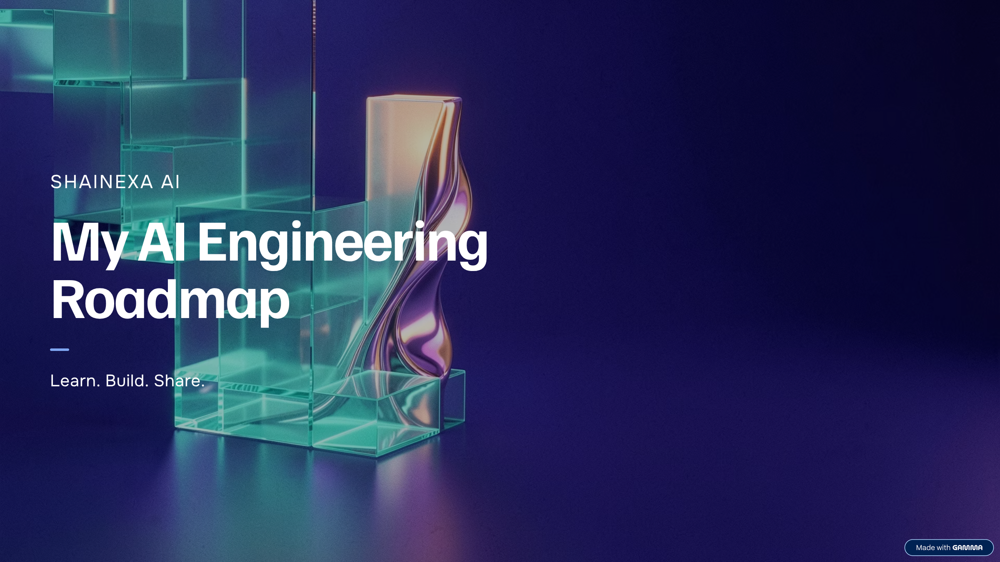

# 🚀 My AI Engineering Roadmap | ShaiNexa AI

Welcome to my AI Engineering learning journey!

I'm building my knowledge of Python, Machine Learning, Generative AI, and AI application development through structured learning, hands-on practice, and practical projects.

My goal is to understand the concepts, write code, build useful applications, and share my progress along the way.

## 🎯 Learning Roadmap

### 1. Python & Core Foundations
- Python functions and object-oriented programming
- NumPy and Pandas
- Git and GitHub
- REST APIs, HTTP, and JSON

### 2. Machine Learning
- Data preprocessing and feature engineering
- Supervised and unsupervised learning
- Scikit-learn
- Model evaluation and validation

### 3. Generative AI & LLMs
- Large Language Model fundamentals
- Prompt engineering
- LLM API integration
- Structured outputs and tool calling

### 4. Retrieval-Augmented Generation (RAG)
- Embeddings and document chunking
- Vector search and vector databases
- Retrieval evaluation and reranking
- Building document-based question-answering systems

### 5. AI Agents & Frameworks
- LangChain and LangGraph
- AI tools and agent workflows
- Model Context Protocol (MCP)
- Testing and evaluating agent behavior

### 6. AI Application Development
- Flask and FastAPI
- REST and WebSocket APIs
- Testing and error handling
- Docker and deployment fundamentals

### 7. MLOps & Cloud
- MLflow and DVC
- Workflow orchestration
- Docker-based deployment
- Exploring Azure ML, AWS SageMaker, and Google Cloud Vertex AI

## 🛠️ How I Plan to Learn

1. Study the fundamentals.
2. Practice with small coding exercises.
3. Build practical projects.
4. Document my code and lessons learned.
5. Share progress and improve through feedback.

## 📈 Progress Tracker

-  Python and API foundations
-  Machine learning practice
-  First RAG application
-  First Generative AI application
-  First AI agent project
-  Deploy an AI application

I'll update these checkboxes as I complete each milestone.

## 🌐 Connect With Me

- **GitHub:** [@shaileshghewade](https://github.com/shaileshghewade)
- **Instagram:** [@shainexa.ai](https://www.instagram.com/shainexa.ai/)
- **LinkedIn:** [Shailesh Ghewade](https://www.linkedin.com/in/shailesh-ghewade-b85889284/)

---

Learning in public. Building step by step. Growing with every project.

ShaiNexa AI — Learn. Build. Evolve.

## 🗺️ My AI Engineering Roadmap

This roadmap represents my learning journey from Python fundamentals to building practical Generative AI applications.

Follow my progress as I learn, build projects, and share what I discover.

Connect with ShaiNexa AI:[Instagram](https://www.instagram.com/shainexa.ai/)
